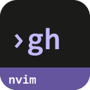
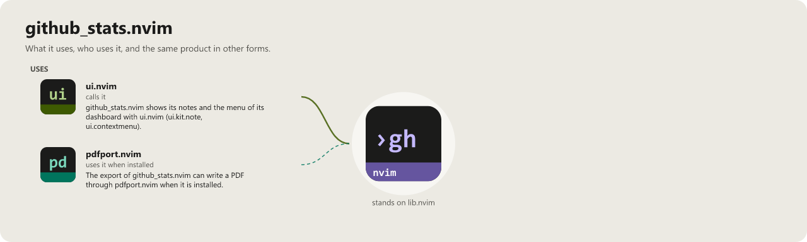

> **Beta stage — active development.** This repository is past its first shape and in
> active use, but the surface is not frozen: breaking changes are still possible. Pin a
> commit or tag if you depend on it.

# github_stats.nvim

```
   ____ _ _   _   _       _       ____  _        _
  / ___(_) |_| | | |_   _| |__   / ___|| |_ __ _| |_ ___
 | |  _| | __| |_| | | | | '_ \  \___ \| __/ _` | __/ __|
 | |_| | | |_|  _  | |_| | |_) |  ___) | || (_| | |_\__ \
  \____|_|\__|_| |_|\__,_|_.__/  |____/ \__\__,_|\__|___/
                                                   .nvim
```

[](LICENSE)
[](https://neovim.io)
[](https://www.lua.org)

[](https://github.com/WKDSteve/github_stats.nvim/actions/workflows/ci.yml)
[](https://wkdsteve.github.io/wkd/p/github_stats/)

> Part of the [wkd](https://wkdsteve.github.io/wkd/) family — see this plugin's [page](https://wkdsteve.github.io/wkd/p/github_stats/) on the site.

GitHub keeps clones, views, referrers and paths for **fourteen days** and then
throws them away. This plugin collects them in the background before that
happens, analyses the history it builds, and exports it — all from inside
Neovim.

By default the collecting is not even done by your editor: on the first start a
short guide sets up a **private data repository** whose GitHub Actions workflow
collects every day, and every machine you use only pulls it. Same history
everywhere, nothing fetched twice, no day lost when no editor runs. Prefer the
plugin to fetch by itself? `storage = "local"`. See
[Where the history lives](docs/FEATURES/REMOTE.md).

---

## Around it

> **[reposcope.nvim](https://github.com/WKDSteve/reposcope.nvim)** — a
> repository browser and switcher. This plugin tells you which of your
> repositories people are actually looking at; reposcope is how you jump into one.
>
> **[insights.nvim](https://github.com/WKDSteve/insights.nvim)** — traffic is
> the outside view of a repository; insights is the inside one.
>
> **[ui.nvim](https://github.com/WKDSteve/ui.nvim)** — puts this week's
> view count for the current repository in the statusline, so the number is
> there without opening the dashboard.
>
> reposcope and insights above are soft: without them everything else works
> unchanged. ui.nvim is not — `require("github_stats")` itself pulls in
> `ui.kit`/`ui.contextmenu` (the dashboard's note popups and right-click
> menu) at module load, before `setup()` even runs. It is a real dependency
> alongside [lib.nvim](https://github.com/WKDSteve/lib.nvim) and `curl` —
> see [Requirements](docs/installation.md#requirements).

---

## Documentation

Start at [docs/README.md](docs/README.md) — what's where, and which question
each page answers.

### The Basics

- [Requirements](docs/installation.md#requirements) — Neovim version, the `lib.nvim` dependency, `curl`, and the GitHub token.
- [Installation](docs/installation.md) — loading strategies and every plugin manager.
- [Quickstart](docs/quickstart.md) — the first thing to run after installing.
- [Where the history lives](docs/FEATURES/REMOTE.md) — remote (a data repository GitHub Actions fills, the default) or local, the setup guide, and the one `storage` key.

### Configuration

- [What you get with the defaults](docs/what-you-get.md) — the commands worth knowing on day one.
- [Configuration guide](docs/configurations/README.md) — token setup, every option with its default, and the two ways to set them.
- [Command reference](docs/commands.md) / [Bindings cheatsheet](docs/BINDINGS.md)
- [Statusline](docs/statusline.md) — this week's view count as a component, for lualine, heirline, the native statusline or ui.nvim.
- [Dashboard guide](docs/dashboard.md) — the interactive dashboard, its keys, and what it can be configured to show.

### The Rest

- [Features](docs/FEATURES/README.md) — the catalog: one page per area, each naming its modules, commands and config keys.
- [Background fetching](docs/background-fetching.md) — when it fetches, and what it costs.
- [Collecting without the editor](docs/cli.md) — `scripts/github_stats.lua collect|report` for a scheduler or CI, so no 14-day window is missed.
- [Workflow](docs/WORKFLOW.md) — how the pieces combine over a session, day to day.
- [Architecture](docs/architecture.md) — module layout and the storage format.
- [Digest](docs/FEATURES/DIGEST.md) — the small per-repository file that lets another program (a desktop app, another plugin) show this traffic without a token: where it is, what is in it, how to find it.
- [Health check](docs/FEATURES/DIAGNOSTICS.md) — what `:checkhealth github_stats` and `:GithubStats debug` report, and how they divide the diagnostic work.
- [Troubleshooting](docs/troubleshooting.md) — common failures, what to run to diagnose them, and the fixes.
- [Cross-platform notes](docs/cross-platform.md)
- [Contributing](docs/CONTRIBUTING.md) — ground rules, project layout, and how to add a subcommand.
- [Feedback](https://github.com/WKDSteve/github_stats.nvim/issues)

`:help github_stats` is the same reference inside the editor.

---

## License

[](LICENSE)

github_stats.nvim is released under the [MIT License](https://opensource.org/licenses/MIT).

<!-- connections:begin (written by the app-icons tool of the workshop; change integrations.json there, not this block) -->
## Connections



**Uses**

- [pdfport.nvim](https://github.com/WKDSteve/pdfport.nvim): The export of github_stats.nvim can write a PDF through pdfport.nvim when it is installed. ([picture](assets/graphs/pair/github_stats.nvim--pdfport.nvim.png))
- [ui.nvim](https://github.com/WKDSteve/ui.nvim): github_stats.nvim shows its notes and the menu of its dashboard with ui.nvim (`ui.kit.note`, `ui.contextmenu`). ([picture](assets/graphs/pair/github_stats.nvim--ui.nvim.png))
- [lib.nvim](https://github.com/WKDSteve/lib.nvim): the shared base of the plugins.

**Used by**

- [docmap-desktop](https://github.com/WKDSteve/docmap-desktop): The traffic view of docmap-desktop reads the traffic digest github_stats.nvim writes. ([picture](assets/graphs/pair/docmap-desktop--github_stats.nvim.png))
- [docmap.nvim](https://github.com/WKDSteve/docmap.nvim): The `traffic` mode of `:DocBrowse` reads the traffic digest that github_stats.nvim publishes for the repository. ([picture](assets/graphs/pair/docmap.nvim--github_stats.nvim.png))
<!-- connections:end -->
